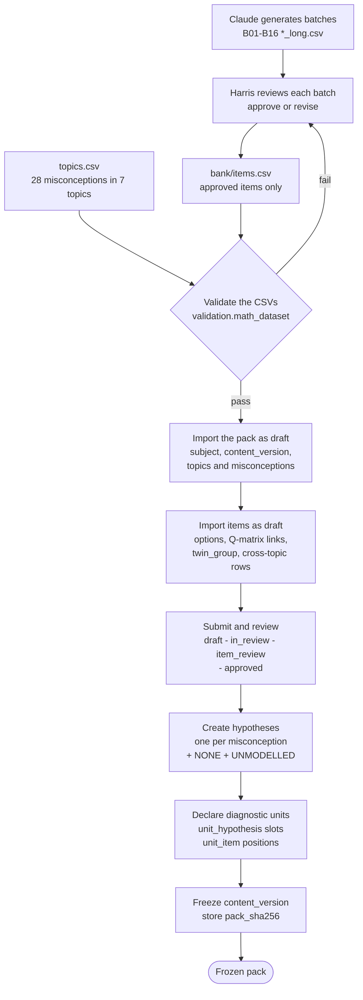
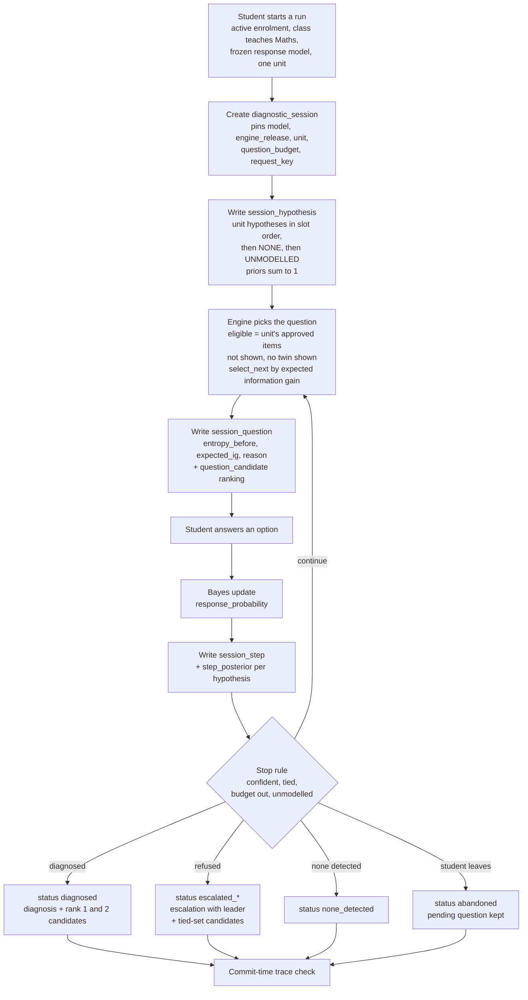

# Iteration 1 data flow

**Task:** T04.04 · **Author:** Harris · **Reviewer:** Ashher · **Status:** draft for review
**Matches:** `docs/db/iteration1/sonder_iteration1.sql` revision 3 (41 tables), `docs/db/iteration1/DB_SCHEMA_PLAN_ITERATION_1.md` and `docs/ENGINE_SPEC_DRAFT.md` (spec v2). Table names refer to the [schema plan](../db/iteration1/DB_SCHEMA_PLAN_ITERATION_1.md); the ERDs are in this folder.

Three flows: (1) how reviewed questions become a frozen content pack, (2) how that pack becomes frozen engine inputs, and (3) how a student's answers become a diagnosis or a refusal. Each step names the tables written and the database rule that checks it, so a step that breaks a rule fails loudly instead of storing bad data.

---

## 1. Reviewed questions to a frozen content pack

| Step | Tables written | What the database checks |
|---|---|---|
| Generate and review batches | none (CSV files) | Nothing yet. Review evidence lives in `data/Maths_v2/batches/reviews/` and the manifest. |
| Validate the CSVs | none | `validation.math_dataset` checks structure (four options, one correct, declared IDs, bank matches batches). It does **not** apply every database rule. |
| Import the pack | `subject`, `content_version` (draft), `topic`, `topic_revision`, `misconception`, `misconception_revision` (validated, engine tier 1), `topic_misconception` | One home topic per misconception (with a coverage target). Everything stays inside one subject and one pack version. |
| Import items | `item` (draft), `item_option`, `option_misconception`, `item_source` | Exactly four options A to D and one correct (checked at commit). The correct option has no link, and a wrong option has at most three. An item's target must be a `keep` misconception of its topic; a target from another topic needs a **cross-topic** `topic_misconception` row with a written reason. `twin_group` marks items with identical stems. `link_grade` is `S` (sound) unless graded `T` (stretch). The author must be an active admin or teacher. If an item is `llm_assisted`, an assistance note is required. |
| Review | `item_review`, `item.review_status` | Approval happens only by inserting an `item_review` row, from an active teacher or admin who is **not the author**, in the next round. In-review and approved items are locked. |
| Hypotheses | `hypothesis` | One per misconception plus `NONE` and `UNMODELLED`. All must be in the same pack. |
| Units | `diagnostic_unit`, `unit_hypothesis`, `unit_item` | Hypothesis slots 0 to k-1 and item positions 0 to n-1 with no gaps. Every unit item must be approved. **Rule V5':** every misconception linked on a unit's item must be one of the unit's hypotheses. |
| Freeze | `content_version` (status frozen, `pack_sha256`) | Needs a hash, at least one approved item, no draft or in-review items, a source on each curated item, the two reserved hypotheses, every target and hypothesis engine-ready, a home topic for every cross-topic misconception, and at least one unit. After that the pack and everything under it are immutable. |

Order matters: the reserved hypotheses and units must exist **before** the freeze, because a frozen pack cannot be changed.

---

## 2. Frozen pack to frozen engine inputs

| Step | Tables written | What the database checks |
|---|---|---|
| Register parameters | `engine_params` | Immutable once written. Column checks for the parameter rules (for example `0 < slip < 0.5`, `0 < guess < 1`, `theta + theta_unmodelled > 1`, `min_support_none >= min_support`). The tighter, item-dependent P1 ceiling on `guess` is checked when the response model freezes (below). |
| Build the response model | `response_model`, `response_parameter`, `response_probability` | Every row belongs to the pack. The probabilities come from the spec's likelihood (section 3.1), computed by a script. For Maths_v2 that is 117 items x 30 hypotheses x 4 options = **14,040 rows**. |
| Freeze the response model | `response_model` (status frozen) | The content version must already be frozen. Every approved item x hypothesis needs exactly four probabilities summing to 1. No unit may have more hypotheses than `k_max`. **P1:** for the largest predicted-set size *s* on any unit item, `guess < (4 - s) / 4`. |
| Register the engine | `engine_release` | Pinned by every run, so a run can be reproduced. |

**P1 consequence for Maths_v2:** three items (T6-011B, T6-014B, T6-016B) link one misconception to three options, so *s* = 3 and `guess` must be below 0.25. The spec's default `guess = 0.30` is refused for any pack whose unit contains them; 0.24 freezes. This is open spec decision D-2.

---

## 3. A student's answers to a diagnosis or a refusal

| Step | Tables written | What the database checks |
|---|---|---|
| Start | `diagnostic_session` | A frozen response model, an active student enrolment in an active class that teaches the pack's subject, and one unit of that pack. `(enrolment, request_key)` is unique, so a retried start is harmless. |
| Priors | `session_hypothesis` | Exactly the unit's hypotheses in the unit's order (slots 0 to k-1), then `NONE` = k and `UNMODELLED` = k+1. They must sum to 1, and the NONE and UNMODELLED priors must equal the pinned `engine_params`. Written before the first question. |
| Choose a question | `session_question`, `question_candidate` | One question at a time, in order, within the budget. Only an approved item of the run's unit, never repeated, never the twin of one already shown. The ranking has ranks 1 to n with non-increasing EIG; rank 1 is the presented item with its `expected_ig`; exact ties are in pack order (`unit_item.position`). |
| Answer | `session_step`, `step_posterior` | The answer must be an option of the presented item and carry a non-blank `answer_note`. `(session, request_key)` is unique, so a retried answer returns the stored result. A complete posterior over the run's hypotheses, summing to 1, is required. |
| Finish | `diagnosis` + `diagnosis_candidate`, or `escalation` + `escalation_candidate` | A `diagnosed` run needs a rank-1 misconception candidate. An `escalated_*` run needs an `escalation` with a leader from the same run; a `escalated_no_separator` refusal needs a tied set of at least two. The ceiling p(leader) / p(tied set) is derived from the last posterior, never stored. |
| Commit | (all of the above) | The whole trace is checked at commit: posteriors complete and normalised, no unanswered question in a finished run. Questions, answers, priors and posteriors are append-only; a finished run is immutable. |

The six outcomes are `diagnosed`, `none_detected`, `escalated_no_separator`, `escalated_exhausted`, `escalated_unmodelled` and `abandoned`. An invalid answer or invalid content is **rejected** (the write fails), so no outcome is invented for it.

**What each reader sees.** A teacher reads the evidence trail for a run: the question, the full candidate ranking, the answer and its note, and the posterior after each answer. A student sees only that the run is complete and awaiting the teacher; the misconception and probabilities are not shown (teacher review arrives in Iteration 2).

---

## 4. Who builds each part

| Part | Owner | Notes |
|---|---|---|
| Likelihood, prior and Bayes update | Ashher | `sonder_engine/bayes.py`, `model.py` |
| Entropy, expected information gain, `select_next` and its ranking and reason | Harris | `sonder_engine/selection.py`. Its `ranking` is what `question_candidate` stores; its `reason` is `session_question.selection_reason`. |
| Run loop, eligibility, stopping and refusal rules, trace, API, pack loader | Ahmed | Not built yet. Eligibility (unit, unshown, no twin) is decided here, not in `select_next`. |
| Importer for Flow 1 | task T05.07 | Not built. `docs/db/iteration1/tests/import_probe.py` is a throwaway probe that loads `data/Maths_v2` into the schema and rolls back. |
| Schema and its tests | revision 3 merged from Ahmed's branch | `docs/db/iteration1/` |

## 5. How Maths_v2 fits the schema

- 117 items, 468 options, 28 misconceptions become 30 hypotheses (28 + `NONE` + `UNMODELLED`) in seven units U1 to U7 (spec section 2.1). Three items (T6-019B, T6-020B, T6-021B) belong to no unit (spec decision D-4).
- **Three links on one option** (T7-003 option A) now load; the limit is three, and the real constraint is rule P1 above.
- **Cross-topic targets** (an item whose target misconception has another home topic) load as `cross_topic` memberships with a reason. The importer must create them.
- **Topic labels** in `items.csv` differ from `topics.csv` text, so the importer maps labels to units explicitly, never by joining on text.
- **Authorship and review:** the items were generated by Claude and approved by Harris. The schema needs an author who is an admin or teacher, marked `llm_assisted` with a note, and a **different** admin or teacher as reviewer. Resolving who plays each role in the real import is still open (plan, section 12).
- **Link grades:** every link is `S` until the stretch links (about 90) are graded `T`; that grading is spec task T-1 and needs the owner's confirmation.
- **Not yet true:** nothing above has been run for real. The probe shows what fits; the live importer, the run loop and a frozen response model with an agreed `guess` do not exist yet.

## 6. Open items

1. **P1 and `guess`:** pick a `guess` below 0.25, or rework the three three-link items (spec D-2).
2. **Importer (T05.07):** build it from the probe, with real accounts and review attribution.
3. **Run loop (Ahmed):** eligibility, stopping rules and trace recovery against the `session_*` tables.
4. **Validator coverage:** extend `validation.math_dataset` to the database's own rules (V5', cross-topic memberships, label to unit mapping) so problems show up before import.
5. **Student view:** confirm the rule that a student never sees an unreviewed diagnosis (plan, open question 1).
