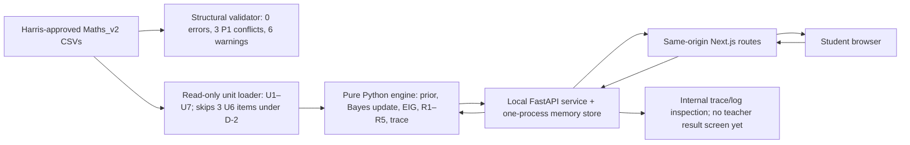
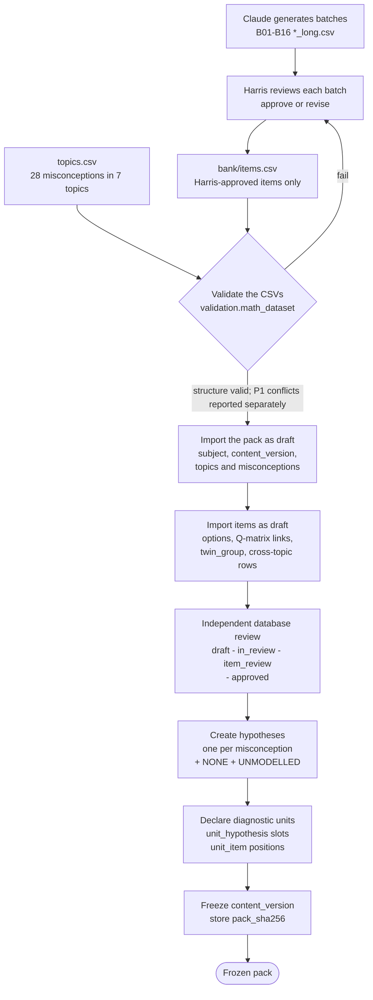
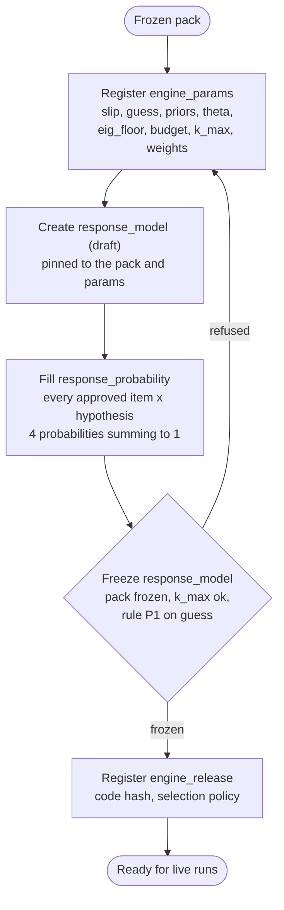
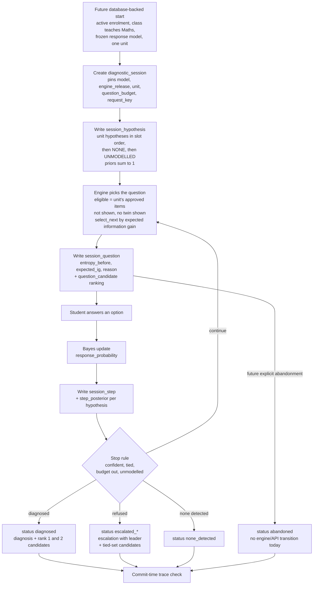

# Iteration 1 data flow

**Task:** T04.04 · **Author:** Harris · **Technical review:** Ashher, 12 Oct 2026 · **Status:** flow-to-code/schema review completed; Harris's content/design acceptance pending
**Matches:** `docs/db/iteration1/sonder_iteration1.sql` revision 3 (41 tables), `docs/db/iteration1/DB_SCHEMA_PLAN_ITERATION_1.md` and `docs/ENGINE_SPEC_DRAFT.md` (spec v2). Table names refer to the [schema plan](../db/iteration1/DB_SCHEMA_PLAN_ITERATION_1.md); the ERDs are in this folder.

This document separates the **current Mid-1 local flow** from the **planned PostgreSQL persistence design**. Sections 1–3 describe tables and guards in the revision 3 schema. They are not claims that the live UI writes those tables. The existing `flow-content-to-live.png` and `flow-answer-to-result.png` illustrate that database design; they are not as-built diagrams of the Mid-1 service.

## 0. Current Mid-1 flow (implemented)

The validator is a review tool, not a runtime gate in the browser path. It reports the three P1 conflicts at the default `guess=0.30`; the loader excludes those items from U6 without editing the CSV. The loader also records source hashes and unit warnings. The service keeps sessions and replies in memory, and the browser receives only a question or neutral completion, never a diagnosis or posterior. Restarting the service loses runs. No live run is written to PostgreSQL. `docs/db/iteration1/tests/import_probe.py` separately tests the schema in a rollback-only, throwaway database.

---

## 1. Reviewed questions to a frozen content pack (planned database path)

| Step | Tables written | What the database checks |
|---|---|---|
| Generate and review batches | none (CSV files) | Nothing yet. Review evidence lives in `data/Maths_v2/batches/reviews/` and the manifest. |
| Validate the CSVs | none | `validation.math_dataset` checks structure (four options, one correct, declared IDs, bank matches batches) and reports P1 contract conflicts. Its default exit status can still be zero with P1 conflicts; use `--strict-contract` for a failing gate. It does **not** apply every database rule. |
| Import the pack | `subject`, `content_version` (draft), `topic`, `topic_revision`, `misconception`, `misconception_revision` (validated, engine tier 1), `topic_misconception` | One home topic per misconception (with a coverage target). Everything stays inside one subject and one pack version. |
| Import items | `item` (draft), `item_option`, `option_misconception`, `item_source` | Exactly four options A to D and one correct (checked at commit). The correct option has no link, and a wrong option has at most three. An item's target must be a `keep` misconception of its topic; a target from another topic needs a **cross-topic** `topic_misconception` row with a written reason. `twin_group` marks items with identical stems. `link_grade` is `S` (sound) unless graded `T` (stretch). The author must be an active admin or teacher. If an item is `llm_assisted`, an assistance note is required. |
| Review | `item_review`, `item.review_status` | Approval happens only by inserting an `item_review` row, from an active teacher or admin who is **not the author**, in the next round. In-review and approved items are locked. Harris's approval in the CSV is content provenance, not proof that this database review occurred. The actual importer and reviewer attribution are still open. |
| Hypotheses | `hypothesis` | One per misconception plus `NONE` and `UNMODELLED`. All must be in the same pack. |
| Units | `diagnostic_unit`, `unit_hypothesis`, `unit_item` | Hypothesis slots 0 to k-1 and item positions 0 to n-1 with no gaps. Every unit item must be approved. **Rule V5':** every misconception linked on a unit's item must be one of the unit's hypotheses. |
| Freeze | `content_version` (status frozen, `pack_sha256`) | Needs a hash, at least one approved item, no draft or in-review items, a source on each curated item, the two reserved hypotheses, every target and hypothesis engine-ready, a home topic for every cross-topic misconception, and at least one unit. After that the pack and everything under it are immutable. |

Order matters: the reserved hypotheses and units must exist **before** the freeze, because a frozen pack cannot be changed.

---

## 2. Frozen pack to frozen engine inputs (planned database path)

| Step | Tables written | What the database checks |
|---|---|---|
| Register parameters | `engine_params` | Immutable once written. Column checks for the parameter rules (for example `0 < slip < 0.5`, `0 < guess < 1`, `theta + theta_unmodelled > 1`, `min_support_none >= min_support`). The tighter, item-dependent P1 ceiling on `guess` is checked when the response model freezes (below). |
| Build the response model | `response_model`, `response_parameter`, `response_probability` | Every row belongs to the pack. The probabilities come from the spec's likelihood (section 3.1), computed by a script. For Maths_v2 that is 117 items x 30 hypotheses x 4 options = **14,040 rows**. |
| Freeze the response model | `response_model` (status frozen) | The content version must already be frozen. Every approved item x hypothesis needs exactly four probabilities summing to 1. No unit may have more hypotheses than `k_max`. **P1:** for the largest predicted-set size *s* on any unit item, `guess < (4 - s) / 4`. |
| Register the engine | `engine_release` | Pinned by every run, so a run can be reproduced. |

**P1 consequence for Maths_v2:** three items (T6-011B, T6-014B, T6-016B) link one misconception to three options, so *s* = 3 and `guess` must be below 0.25 **if those items belong to the unit's response model**. D-2 now keeps the default `guess=0.30` and skips those three items from U6; it also drops MATH-1416 from U6. The approved CSV rows remain in the pack. The rollback-only import probe freezes response models at both 0.30 and 0.24; 0.24 is a tested alternative, not the selected live parameter. No frozen response model is used by the Mid-1 UI.

---

## 3. A student's answers to a diagnosis or a refusal (planned database path)

| Step | Tables written | What the database checks |
|---|---|---|
| Start | `diagnostic_session` | A frozen response model, an active student enrolment in an active class that teaches the pack's subject, and one unit of that pack. `(enrolment, request_key)` is unique, so a retried start is harmless. |
| Priors | `session_hypothesis` | Exactly the unit's hypotheses in the unit's order (slots 0 to k-1), then `NONE` = k and `UNMODELLED` = k+1. They must sum to 1, and the NONE and UNMODELLED priors must equal the pinned `engine_params`. Written before the first question. |
| Choose a question | `session_question`, `question_candidate` | One question at a time, in order, within the budget. Only an approved item of the run's unit, never repeated, never the twin of one already shown. The ranking has ranks 1 to n with non-increasing EIG; rank 1 is the presented item with its `expected_ig`; exact ties are in pack order (`unit_item.position`). |
| Answer | `session_step`, `step_posterior` | The answer must be an option of the presented item and carry a non-blank `answer_note`. `(session, request_key)` is unique and prevents a duplicate stored step; the future API would need to implement returning the prior reply. A complete posterior over the run's hypotheses, summing to 1, is required. |
| Finish | `diagnosis` + `diagnosis_candidate`, or `escalation` + `escalation_candidate` | A `diagnosed` run needs a rank-1 misconception candidate. An `escalated_*` run needs an `escalation` with a leader from the same run; a `escalated_no_separator` refusal needs a tied set of at least two. The ceiling p(leader) / p(tied set) is derived from the last posterior, never stored. |
| Commit | (all of the above) | The whole trace is checked at commit: posteriors complete and normalised, no unanswered question in a finished run. Questions, answers, priors and posteriors are append-only; a finished run is immutable. |

The schema permits six terminal statuses: `diagnosed`, `none_detected`, `escalated_no_separator`, `escalated_exhausted`, `escalated_unmodelled` and `abandoned`. The implemented engine/API produces the first five; `abandoned` has no current transition. An invalid answer or invalid content is **rejected**, so no outcome is invented for it.

**What each reader sees.** The current student UI shows questions and then a neutral completion; it never receives the diagnosis or posterior. The current evidence trail is available through internal service inspection and optional trace logging, not a teacher results screen. A future database-backed teacher view may read the stored question ranking, answers, posterior and decision after the appropriate review controls are implemented.

---

## 4. Who builds each part

| Part | Owner | Notes |
|---|---|---|
| Likelihood, prior and Bayes update | Ashher | `sonder_engine/bayes.py`, `model.py` |
| Entropy, expected information gain, `select_next` and its ranking and reason | Harris | `sonder_engine/selection.py`. Its `ranking` is what `question_candidate` stores; its `reason` is `session_question.selection_reason`. |
| Run loop, stopping and refusal rules, trace, API, pack loader | Ahmed | Implemented for the Maths local checkpoint. The run loop filters unit items by asked/twin eligibility before calling Harris's `select_next`; the API holds sessions in memory. |
| Importer for Flow 1 | task T05.07 | Not built. `docs/db/iteration1/tests/import_probe.py` is a throwaway probe that loads `data/Maths_v2` into the schema and rolls back. |
| Schema and its tests | revision 3 merged from Ahmed's branch | `docs/db/iteration1/` |

## 5. How Maths_v2 fits the schema

- 117 items, 468 options, 28 misconceptions become 30 hypotheses (28 + `NONE` + `UNMODELLED`) in seven units U1 to U7 (spec section 2.1). Three items (T6-019B, T6-020B, T6-021B) belong to no unit (spec decision D-4).
- **Three links on one option** (T7-003 option A) now load; the limit is three, and the real constraint is rule P1 above.
- **Cross-topic targets** (an item whose target misconception has another home topic) load as `cross_topic` memberships with a reason. The importer must create them.
- **Topic labels** in `items.csv` differ from `topics.csv` text, so the importer maps labels to units explicitly, never by joining on text.
- **Authorship and review:** the items were generated by Claude and approved by Harris. The schema needs an author who is an admin or teacher, marked `llm_assisted` with a note, and a **different** admin or teacher as reviewer. Resolving who plays each role in the real import is still open (plan, section 12).
- **Link grades:** every link is `S` until the stretch links (about 90) are graded `T`; that grading is spec task T-1 and needs the owner's confirmation.
- **Current boundary:** the run loop and student UI do work with the real Maths bank and assumed `guess=0.30`. The rollback-only probe shows how the schema fits, but the production importer, persistent live sessions and real review attribution are not built. The current engine is not calibrated on student responses.

## 6. Open items

1. **Content decision after D-2:** the three skipped U6 items still exist in the bank. Harris and the team must decide whether to repair their links or retain the explicit exclusion; Ashher's T1 link sign-off also remains open.
2. **Importer (T05.07):** build a real import with accounts and independent item-review attribution. The rollback-only probe is not that importer.
3. **Persistent runs:** connect the existing engine trace to the `session_*`, `diagnosis` and `escalation` tables; current runs disappear on service restart.
4. **Validator and owner sign-off:** keep P1 strict-contract checks, resolve the six topic-label mappings through the unit configuration, and record Harris's decisions on disputed content links before claiming a frozen reviewed demo pack.
5. **Teacher result view:** implement review access to the trace. The student view already hides diagnosis and probabilities; teacher approval before release is not implemented.
