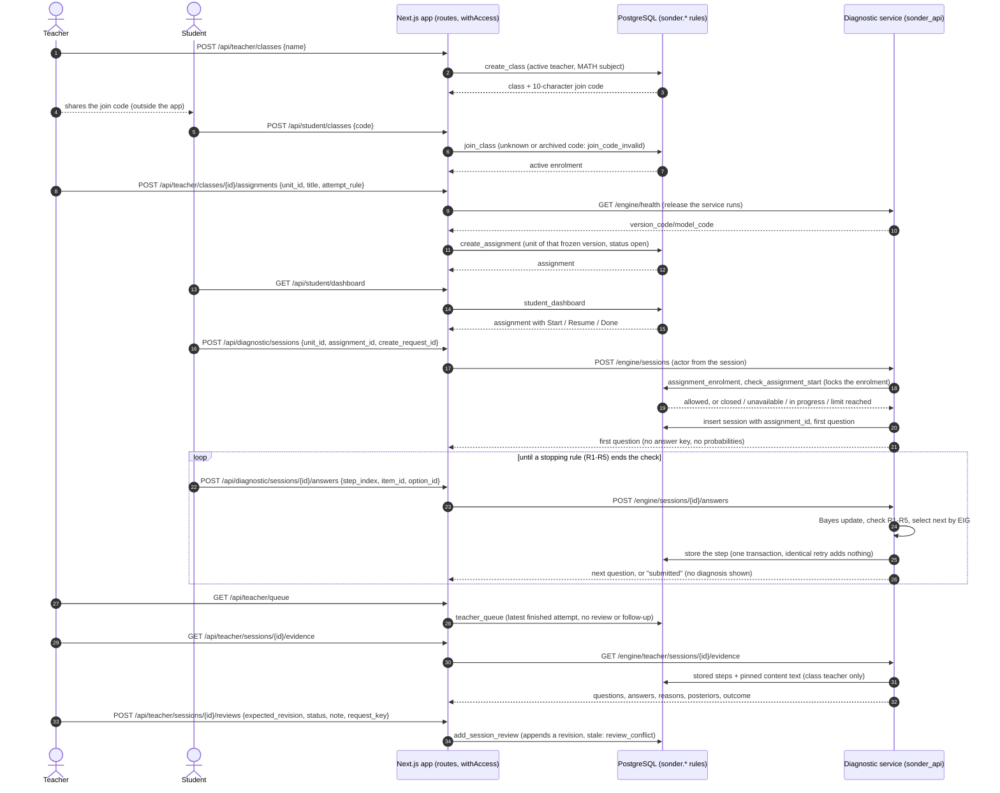
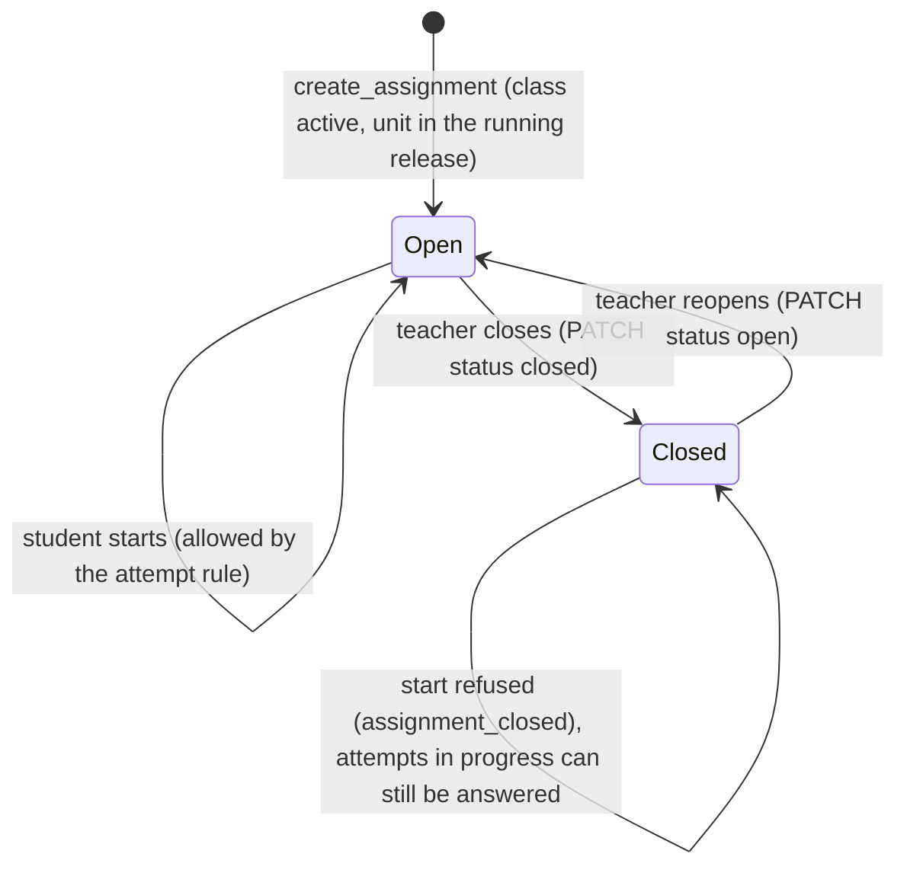
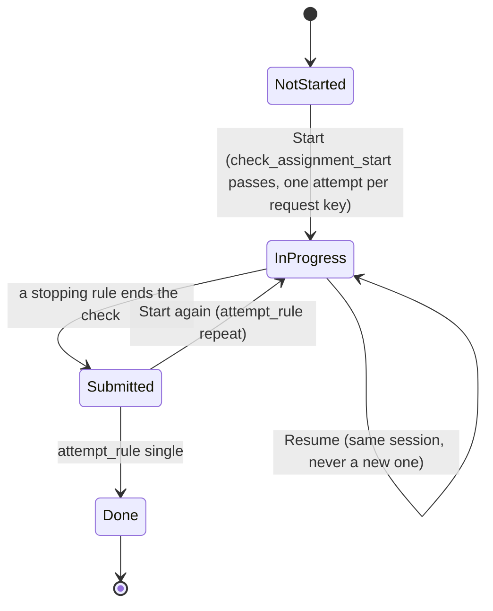
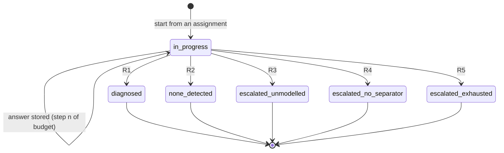
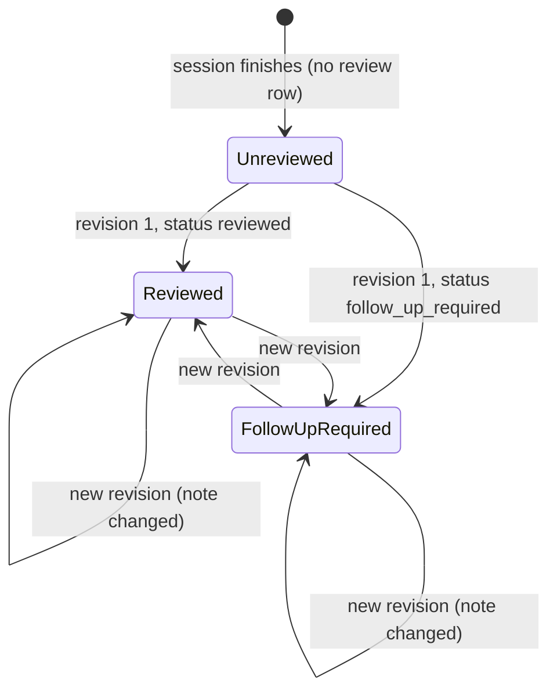

# Iteration 2 product flow: class, assignment, check, evidence, review

**Task:** I2-D09 (diagrams for the implemented change) · **Owner:** Syed Ashher Majid · **Technical reviewers:** Ahmed Laiq (session start, access), Muhammad Harris Azhar (dashboards, evidence)
**Version described:** `dev` at `7ff9978` (24 November 2026), including the assignment-only flow of #93 (migration 0013). Everything shown here is implemented; nothing is planned behaviour. The diagnostic itself (R1–R5) is the [Iteration 1 state machine](STATE_MACHINE_ITERATION_1.md), unchanged.

**Exports** (rendered from the Mermaid source below with Mermaid 11.4.1; regenerate them when the source changes): [sequence](i2-product-flow/i2-1-sequence.png), [assignment](i2-product-flow/i2-2-assignment-state.png), [attempts](i2-product-flow/i2-3-attempt-state.png), [stored check](i2-product-flow/i2-4-session-state.png), [review](i2-product-flow/i2-5-review-state.png), each also as SVG.

Rules live in PostgreSQL functions (`sonder.*`, migrations `0003`–`0013`) and are tested on a real PostgreSQL in `tests/test_product_*.py`. The browser reaches them only through the Next.js routes, which take the account from the session (`withAccess`), never from the request. Contracts: [classes and assignments](../api/CLASS_ASSIGNMENT_CONTRACT.md), [sessions](../api/SESSION_CONTRACT.md), [access](../api/ACCESS_CONTRACT.md), [requirements](I2_TEACHER_STUDENT_REQUIREMENTS.md).

## 1. End-to-end sequence

| Step | Implemented by | Tested in |
| --- | --- | --- |
| 1–3 class | `sonder.create_class` (0003), `app/api/teacher/classes` | `test_product_classes.py` |
| 4–7 join | `sonder.join_class` (0004), `app/api/student/classes` | `test_product_membership.py` |
| 8–12 assignment | `sonder.create_assignment` (0005), `lib/classes/server.ts` (release from `/engine/health`) | `test_product_assignments.py` |
| 13–15 dashboard | `sonder.student_dashboard` (0011, replaced in 0013) | `test_product_student_dashboard.py` |
| 16–21 start | `sonder.assignment_enrolment`, `sonder.check_assignment_start` (0007), `sonder_api/pgstore.py` | `test_product_assignment_start.py`, `test_product_assignment_concurrency.py`, `test_product_session_link.py` |
| 22–26 answers | `sonder_api` session commands, `sonder_engine` (R1–R5) | `test_persist_*.py`, Iteration 1 engine tests |
| 27–28 queue | `sonder.teacher_queue` (0013), `app/api/teacher/queue` | `test_product_flow_queue.py` |
| 29–32 evidence | `sonder_api/teacher_evidence.py`, `app/api/teacher/sessions/[sessionId]/evidence` | `test_product_evidence.py`, `test_product_teacher_path.py` |
| 33–34 review | `sonder.add_session_review` (0009), `app/api/teacher/sessions/[sessionId]/reviews` | `test_product_reviews.py` |

The whole path is also exercised end to end against the Neon development branch by `scripts/check_class_flow.py` and `scripts/check_product_flow.py` ([path checks](../testing/PRODUCT_PATH_CHECKS.md)).

## 2. An assignment

- The unit, class, attempt rule and creator are fixed once created (`class_assignment_guard`).
- An open assignment whose unit is no longer in the release the service runs refuses starts with `assignment_unavailable`. A closed one gives `assignment_closed` first (`check_assignment_start` checks closed, then the release, then the attempt rule).
- Archiving the class (`set_class_status`) or removing the student stops new starts in that class, but does not end an attempt in progress.

## 3. One student's attempts at one assignment

| State | Student dashboard | Teacher activity (`class_activity`) | Start request |
| --- | --- | --- | --- |
| NotStarted | **Start** | Not started | allowed if open |
| InProgress | **Resume** (also while closed) | In progress | `409 attempt_in_progress` |
| Submitted, `repeat` | **Start** a new attempt | Completed (latest attempt) | allowed if open |
| Done (`single`) | **Done**, no action | Completed | `409 attempt_limit_reached` |

"Latest" is by `started_at`, then id. Every attempt is listed on the evidence page (`session_attempts`) and in the student's history with "Attempt k" (`student_history`). The session status column also allows `abandoned`, but no transition reaches it yet.

## 4. A stored check (diagnostic session)

A finished session is immutable (database trigger): no step can be added and its status cannot change. The student sees only "submitted"; the five finished statuses, the diagnosis and the probabilities are teacher-only (requirements §2).

## 5. A teacher's review of a finished check

- Every change **appends** a revision (`session_review`); nothing is updated or deleted, and each revision keeps who and when.
- A write names the revision it expects. Someone else's write in between gives `409 review_conflict`. An identical retry with the same request key returns the same revision.
- Only the class's active teacher can review, and only a finished session (`session_unfinished` otherwise).
- A review never changes the engine's result and never reaches the student ("Reviewed is not approval for release").

**Teacher queue** (`teacher_queue`): a finished latest attempt is listed as *Needs review* while Unreviewed and as *Follow-up required* while its latest revision is FollowUpRequired; a Reviewed check leaves the queue. Checks started without an assignment (only possible through the service's harness since #93) appear read-only under "Other checks" (`class_other_checks`).

## 6. What these diagrams do not show

- Sign-in, roles and approval of teacher accounts ([persistence and access](PERSISTENCE_AND_ACCESS.md)).
- Error replies other than those named; the full list is in the contracts.
- The diagnostic's internal states (selection, update, R1–R5 order), which are in the [Iteration 1 state machine](STATE_MACHINE_ITERATION_1.md).
