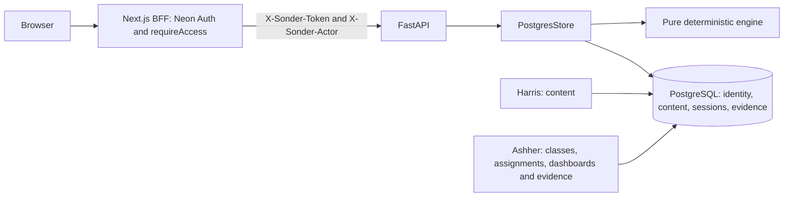
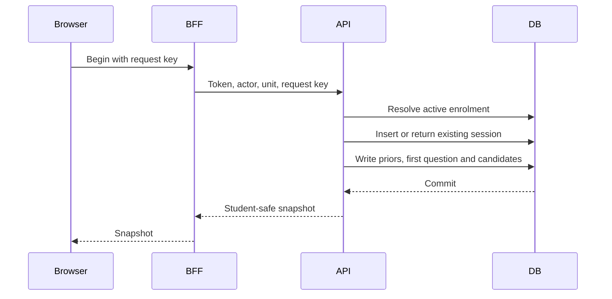
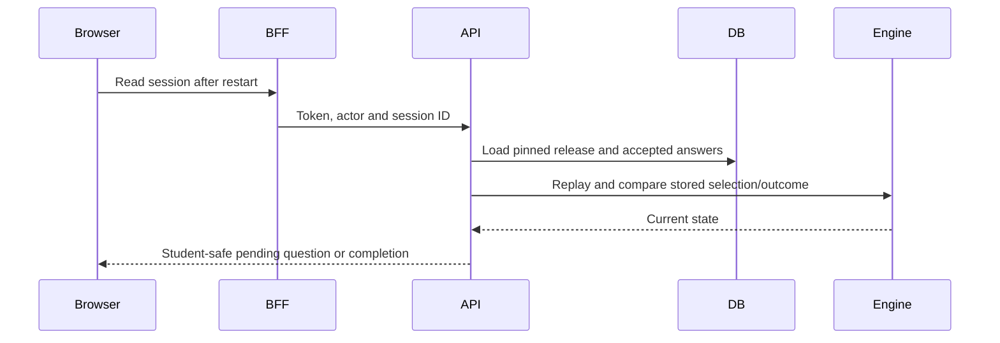

# Persistence and access architecture

## Components



## Start



## Answer and retries

```mermaid
sequenceDiagram
  Browser->>BFF: Answer step
  BFF->>API: Token, actor and answer
  API->>DB: Lock session row
  API->>DB: Load pinned release and accepted answers
  API->>Engine: Replay and compare questions/outcome
  Engine-->>API: Calculate transition
  API->>DB: Write step, posterior and next question or outcome
  DB-->>API: Commit atomically
  API-->>BFF: Student-safe snapshot
  Note over API,DB: Identical retry returns original transition; conflict is refused
```

## Restart and resume



## Decisions

- **D1. Reuse the Iteration 1 schema unchanged** (`docs/db/iteration1/sonder_iteration1.sql`, 41 tables). Its run tables (`diagnostic_session`, `session_hypothesis`, `session_question`, `question_candidate`, `session_step`, `step_posterior`, `diagnosis*`, `escalation*`) already model exactly what the engine trace holds, and their triggers re-check every write at commit. No new session tables are needed.
- **D2. Event-sourced, stateless service.** The service holds **no session state in memory**. Every request loads the session's pinned release and accepted answers from the database and rebuilds the engine state with `sonder_engine.session.replay`. The engine is deterministic (no clock, randomness, or I/O), so the rebuild is exact. Before replying, the rebuilt asked items and outcome are compared with the stored rows; a difference returns `500 replay_mismatch` and writes nothing. This makes restart/resume trivial and correct (I2-L04).
- **D3. One answer = one transaction.** `SELECT … FOR UPDATE` on the `diagnostic_session` row serialises concurrent requests for the same session (also across processes). The step, its posterior, and either the next question with its candidate ranking or the final outcome rows are written together; the deferred `trace_complete` trigger checks them at `COMMIT`. A crash before commit leaves nothing (verified, §3.4 item 6).
- **D4. Idempotency.** Start: `UNIQUE (enrolment_id, request_key)` with `request_key = create_request_id`; a repeated start returns the original first-question snapshot (recomputed deterministically); same key with a different unit → `409 create_conflict` (the key is looked up **before** the unit). Answer: identity is `(session, step_index)`; an identical retry of an accepted step returns that step's original reply, recomputed from the accepted prefix; a different option/item for an accepted step → `409 answer_conflict`. `session_step.request_key` is stored as `answer:<step_index>`.
- **D5. Exact numbers.** Floats are written to `numeric` through `sonder_db.num()` (`Decimal(repr(x))`), so `float(stored) == engine value` bit for bit (verified for every posterior, prior, EIG, entropy and the 480 response-probability rows).
- **D6. Release pinning.** A "release" is one frozen `response_model` row named `<content_version.version_code>/<response_model.model_code>`. The API process is started with one release for **new** sessions (`--release`). Each session stores `response_model_id` (→ content version, engine params) and `engine_release_id`; old sessions are always rebuilt from **their own** pinned release, so a later release never alters them (verified, §3.4 item 8).
- **D7. Engine identity.** `engine_release.release_code = "<sonder_engine.__version__>+<first 12 hex of SHA-256 over sonder_engine/*.py>"`, registered at startup. Replay uses the running engine code; if engine code changes in a way that alters behaviour, `replay_mismatch` exposes it rather than silently changing evidence (documented limitation).
- **D8. Content before Harris's importer.** `python -m sonder_api.devseed` loads **U1 only** from `data/Maths_v2` into a frozen development release `Maths_v2-U1-dev/spec-v2-prior`, plus placeholder accounts and one development class (`DEVSEED01`). It refuses to run without `SONDER_ALLOW_DEV_SEED=true`. When Harris's importer (I2-H14–H16) lands, the API is simply started with Harris's release name; no service code changes.
- **D9. Enrolment binding.** A start without `assignment_id` resolves the actor's single active enrolment in an active class that teaches the release's subject. None → `403 enrolment_required`; more than one → `409 enrolment_ambiguous`. A start with `assignment_id` (I2-H12) resolves the enrolment through the assignment instead and applies its open/release/attempt rules (SESSION_CONTRACT §5.5).
- **D10. No silent fallback.** The service must be started with an explicit `--store postgres|memory`. If PostgreSQL is unreachable at startup the process exits non-zero; during a request it returns `503 storage_unavailable`. The in-memory store remains only as an explicit developer/test mode.
- **D11. Migrations.** A tiny runner (`sonder_db.migrate`) applies files listed in `db/migrations/manifest.json` exactly once, records their LF-normalised SHA-256 in `sonder_meta.schema_migration`, refuses changed applied files, and serialises runners with an advisory lock. The Iteration 1 schema and `001-auth-rbac.sql` are entries 0001 and 0002 **by path** (no copies). Existing hand-built databases (Ahmed's Neon dev branch) use `adopt` once.
- **D12. Driver.** `psycopg[binary]==3.3.9` and `psycopg-pool==3.3.3`, optional extra `db`. Pool created with `prepare_threshold=None` (safe with Neon's pooler) and `check=ConnectionPool.check_connection` (dropped connections are replaced; after a server-side kill the first request gets `503`, later requests succeed — verified).


- **D13. Keep Neon Managed Auth** (already merged in PR #45). It provides password hashing, sessions, logout, verification. A second password store would be a "major authentication redesign", which the work division says needs a new estimate. `sonder.password_credential` and `sonder.auth_session` stay unused; this is documented, not deleted.
- **D14. Actor = application account.** The Next.js BFF calls `requireApiRole(["student"])` and sends `X-Sonder-Actor: <account.id>` (the `sonder.app_user.id` UUID) to the Python service with the shared `X-Sonder-Token`. The Python service trusts the actor header **only** together with the token (service-to-service, loopback). The HMAC "owner" and per-run cookie (`lib/diagnostic/owner.ts`, `SONDER_COOKIE_KEY`) are removed: the database binds each session to the enrolment's student, so the actor check replaces the capability cookie.
- **D15. Contract version 2.** All service JSON carries `"contract_version": 2`.


## Limitations

The seed is a development candidate, not expert accepted. Each process chooses one release for new sessions; old sessions retain their own pin. Engine code changes may surface as `replay_mismatch`. There is no retention policy yet, and `abandoned` has no transition (an abandoned attempt would count as used under a `single` assignment). Service replay compares selected questions and outcome; full persisted evidence verification checks posterior and other stored fields. `docs/design/architecture-iteration1.*` remains the Iteration 1 record and is not changed here.
