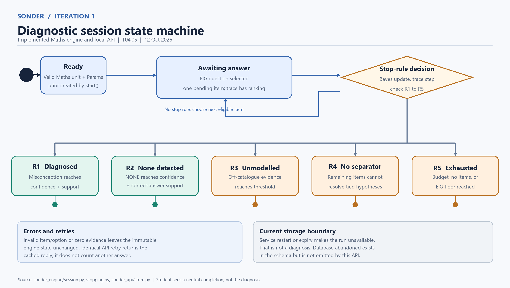

# Iteration 1 diagnostic session state machine

**Task:** T04.05

**Owner:** Ashher

**Scope:** the implemented Maths diagnostic in `sonder_engine` and the local, in-memory `sonder_api` checkpoint. This is the behavior available at Mid-1, not the future database-backed workflow.

```mermaid
stateDiagram-v2
    [*] --> Ready: Load a valid Maths unit and parameters
    Ready --> AwaitingAnswer: start(); next_question() selects highest EIG
    AwaitingAnswer --> AwaitingAnswer: Invalid item/option or numeric error / reject; state unchanged
    AwaitingAnswer --> Deciding: Valid answer / Bayes update; append step and trace; check R1-R5
    Deciding --> AwaitingAnswer: No stopping rule / select next eligible item
    Deciding --> Diagnosed: R1 / misconception confidence and support
    Deciding --> NoneDetected: R2 / NONE confidence and support
    Deciding --> Unmodelled: R3 / off-catalogue evidence
    Deciding --> NoSeparator: R4 / inseparable tied set
    Deciding --> Exhausted: R5 / budget, no items, or EIG floor
    Diagnosed --> [*]
    NoneDetected --> [*]
    Unmodelled --> [*]
    NoSeparator --> [*]
    Exhausted --> [*]
```

| Diagram state | Implemented representation | Meaning |
|---|---|---|
| Ready | `start()` returns `SessionState` with `pending=None` | The unit and parameters pass P1; the prior exists. The local API immediately calls `next_question()`, so the browser normally does not see this intermediate state. |
| Awaiting answer | `decision.outcome == in_progress` and `pending` is a `QuestionRecord` | The current item was selected from unasked, twin-eligible items by expected information gain. Its full candidate ranking and reason are retained in the trace. |
| Deciding | The synchronous work inside `answer()` | The option is validated; the posterior is updated; support and stopping rules R1-R5 are evaluated in that order. This is a transition calculation, not a stored session status. |
| Diagnosed | `diagnosed` | R1: one misconception reaches the confidence and support thresholds. |
| None detected | `none_detected` | R2: `NONE` reaches its confidence and correct-answer support thresholds. |
| Unmodelled | `escalated_unmodelled` | R3: off-catalogue evidence reaches its threshold and support rule. |
| No separator | `escalated_no_separator` | R4: remaining eligible items cannot separate the tied set enough for an honest diagnosis. |
| Exhausted | `escalated_exhausted` | R5: the question budget, item pool, or information-gain floor ends the run without a decision. |

**Error and retry boundary.** `answer()` returns a new immutable state only after a valid calculation. Invalid option, wrong pending item, absent pending question, finished session, or zero-probability evidence raises an error and leaves the original state unchanged. The API caches accepted replies by step and rejects conflicting retries; an identical retry returns the earlier reply, not a second answer. A network failure is not a diagnostic outcome.

**Storage boundary.** The local API keeps runs in one process's memory. A refresh can resume a run while that process and its keys remain available; expiry or service restart makes the run unavailable. The PostgreSQL schema also defines `abandoned`, but the current engine/API does not produce that outcome, so it is deliberately absent from this implemented-state diagram. The schema's `diagnostic_session` and evidence tables are not written by the Mid-1 UI flow.

**Student and reviewer views.** The student response contains the next question or a neutral completion status, never the posterior or diagnosis. The trace can currently be inspected through the local service tooling; there is no teacher results screen yet.

**Evidence checked:** `sonder_engine/session.py`, `stopping.py`, `selection.py`, `trace.py`; `sonder_api/store.py`, `student_view.py`; `tests/test_engine_session.py`, `test_engine_stopping.py`, `test_engine_api.py`; and the planned `diagnostic_session.status` constraint in `docs/db/iteration1/sonder_iteration1.sql`.

The companion image `state-machine-iteration1.png` is a report-ready drawing of the same implemented states and transitions.


